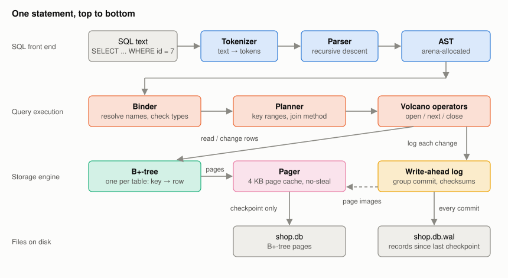
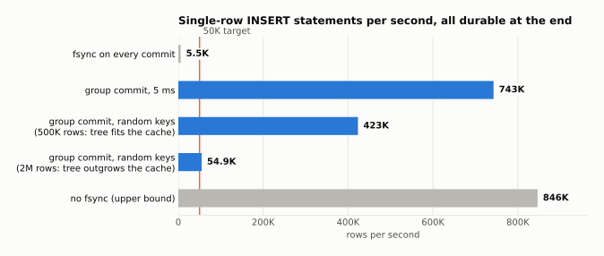

# minidb

A relational database engine written from scratch in C. SQL goes in one end;
rows that survive `kill -9` come out the other. No dependencies beyond libc.



| Layer | What it does | Code |
|---|---|---|
| Tokenizer, parser | Hand-written lexer and recursive-descent parser to an arena-allocated AST | `src/lexer`, `src/parser` |
| Binder | Resolves names, infers types, rejects ill-typed expressions before any row is read | `src/expression` |
| Planner | Turns primary-key predicates into B+-tree ranges; picks index join or nested loop | `src/planner` |
| Executor | Volcano iterators: scan, filter, project, join, sort, limit | `src/operator`, `src/executor` |
| B+-tree | Slotted 4 KB leaf pages, linked for range scans; one tree per table | `src/btree` |
| Pager | Page cache over the database file, clock eviction, free list | `src/pager` |
| WAL | Checksummed logical log, group commit, checkpoints, crash recovery | `src/wal`, `src/storage` |

## Numbers



| | |
|---|---|
| Single-row `INSERT` statements, group commit | **743K rows/s** (733K/s averaged over 10M rows) |
| Same, fsync on every commit | 5.5K rows/s |
| Point lookup by primary key, 1K to 4M rows | 0.6 to 2.0 µs, 2 to 3 pages |
| Join of two 8,000-row tables | 1.6 ms index join, 2.5 s nested loop |

Measured on a 2-vCPU cloud VM (Xeon @ 2.1 GHz, ext4 on a virtual disk, one
fsync ≈ 180 µs). How those numbers were reached, with flamegraphs:
[docs/performance.md](docs/performance.md).

## Try it

```sh
cmake -S . -B build && cmake --build build -j
./build/src/minidb shop.db
```

```
minidb> CREATE TABLE users (id INT PRIMARY KEY, name TEXT, age INT);
minidb> CREATE TABLE orders (id INT PRIMARY KEY, user_id INT, total DECIMAL);
minidb> INSERT INTO users VALUES (1, 'Ada', 36), (2, 'Grace', 45);
minidb> INSERT INTO orders VALUES (10, 1, 99.5), (11, 1, 20), (12, 2, 7.25);
minidb> SELECT u.name, o.total FROM orders o JOIN users u ON u.id = o.user_id
   ...> WHERE o.total > 10 ORDER BY o.total DESC;
name | total
Ada | 99.5
Ada | 20
minidb> SELECT name > 5 FROM users;
error: cannot apply > to TEXT and INT
```

From C, the whole API is `minidb_open`, `minidb_exec` with a row callback, and
`minidb_close` ([include/minidb/minidb.h](include/minidb/minidb.h)).

## SQL it understands

```sql
CREATE TABLE t (id INT PRIMARY KEY, name TEXT, score DECIMAL, ok BOOL);
DROP TABLE t;
INSERT INTO t [(columns)] VALUES (...), (...);
SELECT * | expr [AS name], ... FROM t [alias]
    [JOIN t2 [alias] ON condition] ...
    [WHERE condition] [ORDER BY expr [ASC|DESC], ...] [LIMIT n];
UPDATE t SET column = expr, ... [WHERE condition];
DELETE FROM t [WHERE condition];
```

Expressions: `+ - * /`, `= != <> < <= > >=`, `AND OR NOT`, `LIKE` with `%` and
`_`, parentheses. Types: `INT` (64-bit), `DECIMAL` (double), `TEXT`, `BOOL`.

## How it works

[docs/how-it-works.md](docs/how-it-works.md) walks through the engine in six
diagrams: the query pipeline, the page format, the B+-tree, group commit, and
checkpoint and recovery.

## Working on it

```sh
ctest --test-dir build              # 10 test binaries, one per module
scripts/memcheck.sh                 # the same tests under Valgrind
scripts/run_benchmarks.sh           # every benchmark behind the figures
scripts/plot_benchmarks.py          # redraw docs/img from those runs
scripts/profile.sh out.svg insert --rows 2000000    # flamegraph of a workload
```

Each module is a header in `include/minidb/` and a directory in `src/`. Every
header opens with what the module is for and who owns the memory it hands out.

## Limits

Deliberately out of scope, so the rest could be done properly:

- One connection, one thread. No transactions spanning statements; each
  statement is atomic on its own.
- No `NULL`, no secondary indexes, no aggregates or `GROUP BY`. Joins are inner
  joins. A table's only index is its `INT` primary key.
- A row must fit in 1,000 bytes. Deletes free space within a page but never
  merge pages.
- Group commit trades the last few milliseconds of commits for throughput; use
  `MINIDB_SYNC_FULL` when every commit must survive a power cut.
- Little-endian machines only.
