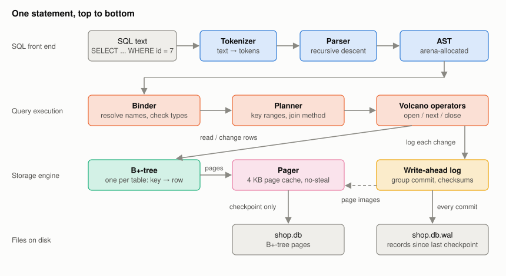
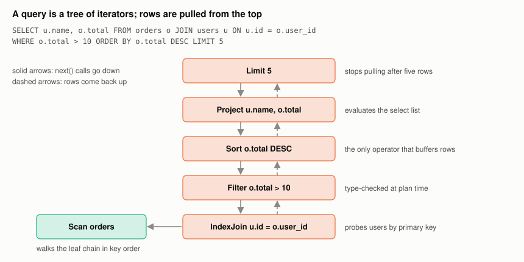
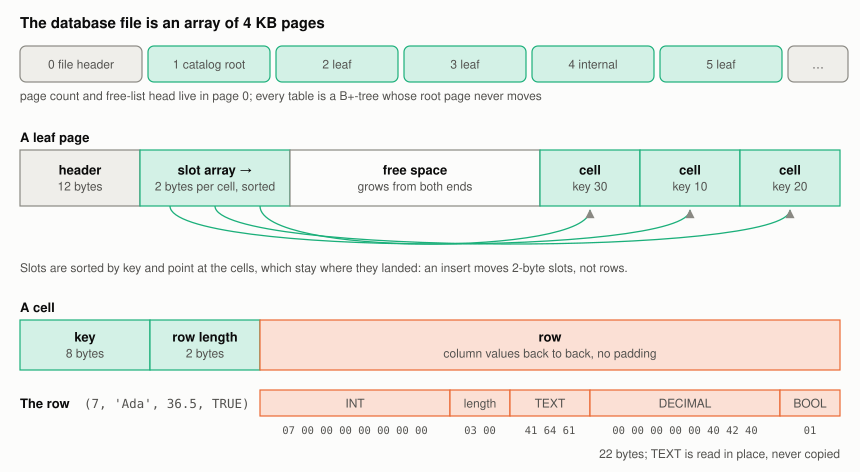
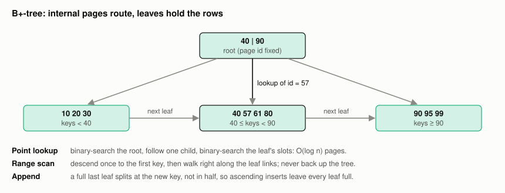
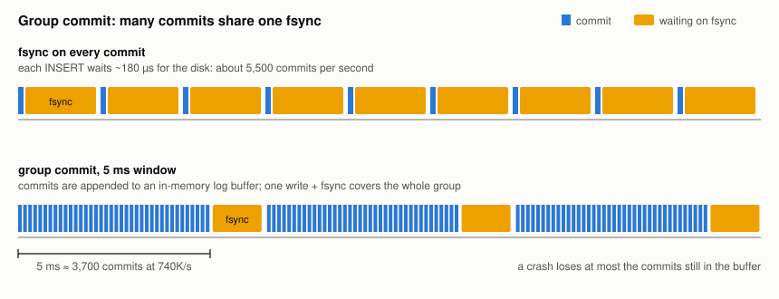
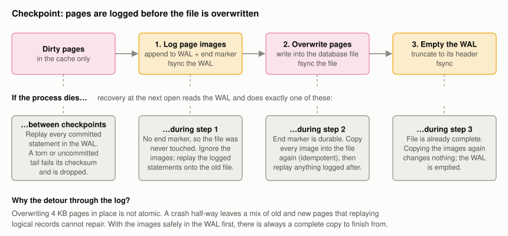

# How minidb works

Six pictures, top of the stack to the bottom.

## 1. From SQL text to a plan

- **Tokenizer** (`src/lexer`): one pass, no allocation. Tokens are views into
  the SQL text.
- **Parser** (`src/parser`): recursive descent, one function per precedence
  level. Builds the AST in a per-statement arena that is freed in one call.
- **Binder** (`src/expression`): resolves each column name to a position in
  the row and gives every node a type. `name > 5` or a non-boolean `WHERE` is
  rejected here, so evaluation never meets a type error.
- **Planner** (`src/planner`): always builds the same stack,
  `Scan → Join → Filter → Sort → Project → Limit`, minus the stages a query
  does not use, and makes two decisions:

| The query says | The planner does |
|---|---|
| `WHERE id = 7`, `id >= 10 AND id < 20` (on the primary key) | Narrows the scan to that key range: one B+-tree descent, no table scan |
| `JOIN users u ON u.id = o.user_id` (right side's primary key) | Index join: one B+-tree probe per left row |
| Any other join condition | Nested-loop join: rescan the right table per left row |

## 2. Running the plan

Every operator implements `open / next / close` (`include/minidb/operator.h`).
The executor calls `next()` on the root; each operator calls `next()` on its
child only when it needs another row. Nothing is materialized except inside
`Sort`.

Rows are **borrowed**: the row an operator returns, and any `TEXT` in it, is
valid until that operator's next call. A scan decodes rows straight out of the
pinned page, so a filter that rejects a row never copied it.

`UPDATE` and `DELETE` run in two phases: collect the matching keys (and new
rows), close the scan, then apply. A statement never scans rows it has already
changed.

## 3. Pages, cells and rows

- The **pager** (`src/pager`) caches pages, pins them while in use, and evicts
  clean ones with a clock sweep. It is *no-steal*: a dirty page is written
  only by a checkpoint, never to make room.
- A **leaf** is a slotted page. Inserting in key order moves 2-byte slots, not
  rows.
- A **row** is its column values back to back in schema order (`src/row`).
  Decoding copies nothing.

## 4. The B+-tree

One tree per table, keyed by the `INT` primary key (or a hidden row id).
Internal pages hold up to 340 `(key, child)` entries, so three levels cover
millions of rows. The root's page id never changes: when the root splits, its
contents move to a new page and the root becomes their parent, so the catalog
stores each root once.

## 5. Durability: the write-ahead log

Every change is applied to the cached pages and appended to the log as a small
logical record (`INSERT row into table 3`): 24 bytes of header plus the row,
protected by a CRC-32. A statement commits by flagging its last record.

| Sync mode | A commit returns when | A crash can lose |
|---|---|---|
| `FULL` | its record is fsynced | nothing |
| `GROUP` (default) | its record is in the log buffer; the buffer is fsynced every 5 ms or 256 KB | the commits still in the buffer |
| `OFF` | its record is in the log buffer | everything since the last checkpoint |

The group-commit window is checked as statements commit, so a program that
goes quiet should call `minidb_sync()`; the shell does after every interactive
statement.

Records of a statement that has not committed never leave the buffer, so a
failed statement is undone in memory and its records are simply dropped.

## 6. Checkpoint and recovery

The database file is only brought up to date by a checkpoint, which runs when
the log passes 32 MB or dirty pages fill three quarters of the cache.

Recovery (`src/storage/recovery.c`) runs when a database is opened:

1. If the log holds a complete checkpoint, copy its page images into the file.
2. Replay every committed statement logged after it, through the same code
   path live changes use.
3. Checkpoint, leaving an empty log.

`tests/test_storage.c` kills a child process at each of the four stages of a
checkpoint, and with a torn log tail, and checks every row afterwards.
