# Performance

Goal: sustain 50K inserts per second. Where it ended up:

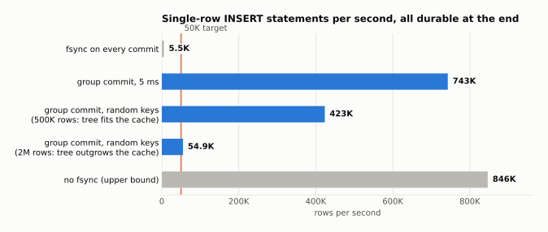

**Setup.** Each insert is its own SQL statement and its own commit, sent
through the public API (`INSERT INTO accounts VALUES (42, 'user42', 42.25,
TRUE)`), so tokenizing, parsing and planning are all on the clock. The clock
stops only after a final fsync. Machine: 2-vCPU cloud VM, Xeon @ 2.1 GHz, ext4
on a virtual disk. It is a shared machine: repeated runs vary by about ±10%,
so figures are medians and small differences mean little.

## 1. Start: one fsync per commit, 5.5K rows/s

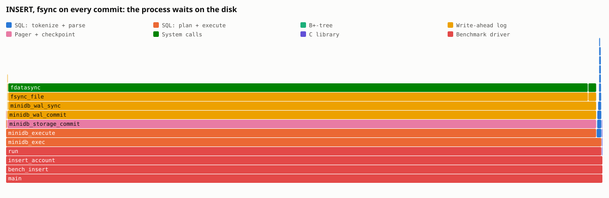

97% of wall-clock time is inside `fdatasync`. The engine barely registers. At
about 180 µs per fsync, 5,500 commits a second is the ceiling whatever the
code does.

## 2. Group commit: 5.5K to roughly 580K rows/s

Stop paying one fsync per commit. Commits are appended to an in-memory log
buffer, and one write plus one fsync covers everything that arrived in the
window.

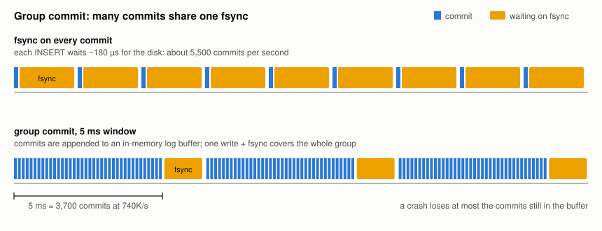

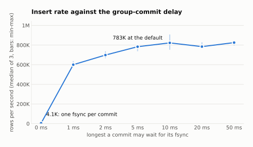

The first millisecond buys nearly everything. Past 5 ms the curve is flat
because the buffer's 256 KB limit triggers the flush first. The default is
5 ms: a crash can lose the commits still in the buffer, and nothing older.
(`MINIDB_SYNC_FULL` keeps the one-fsync-per-commit guarantee.)

## 3. Profile again, fix what it shows

With fsync out of the way, the flamegraph finally shows the engine.

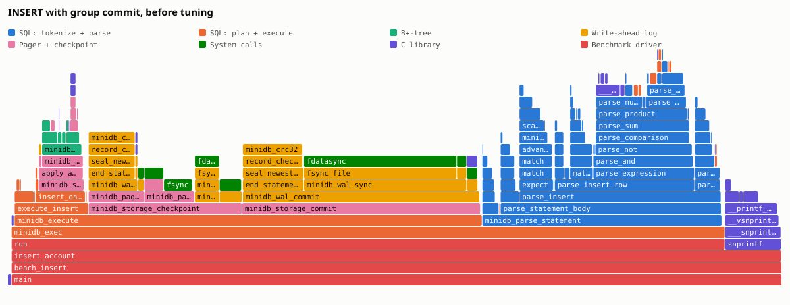

| Share of wall-clock time | Before | After | Fix |
|---|---|---|---|
| `minidb_crc32` (log record checksums) | 13.8% | 4.6% | Slicing-by-8: eight table lookups per 8 bytes instead of one per byte |
| Keyword recognition in the tokenizer | 8.6% | 2.9% | Reject on length and first letter before comparing characters |
| `fdatasync` | 23.0% | 26.9% | Unchanged in absolute terms; it is now a larger share of a shorter run |

Random keys told a different story: 51K rows/s, with **86% of the time inside
checkpoints**.

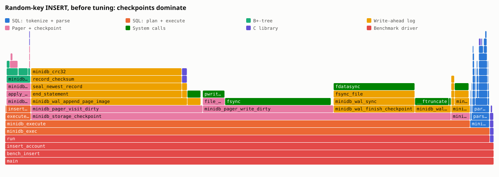

Every insert dirtied a different leaf, the dirty-page limit (16 MB) tripped
every ~7,000 inserts, and each checkpoint rewrote 4,096 pages twice (log, then
file) and checksummed every one. Raising the budget to three quarters of a
64 MB cache lets each rewritten page absorb more changes.

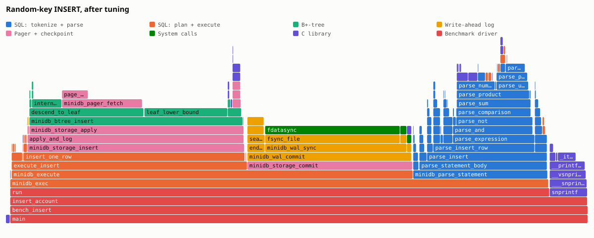

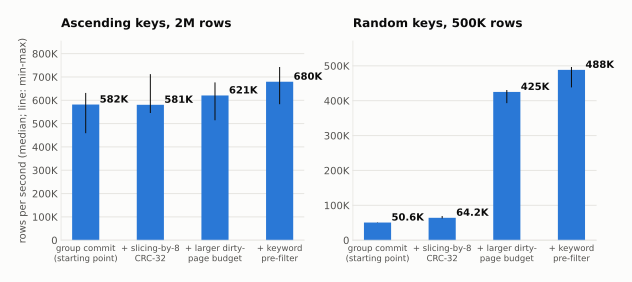

Each bar is the engine at one commit, benchmarked in interleaved rounds (7 for
ascending keys, 3 for random). For ascending keys the individual steps sit
inside the run-to-run noise; the trend across all three (582K to 680K) and the
profile shares above are the evidence. For random keys the checkpoint change
is unmistakable: 51K to 425K.

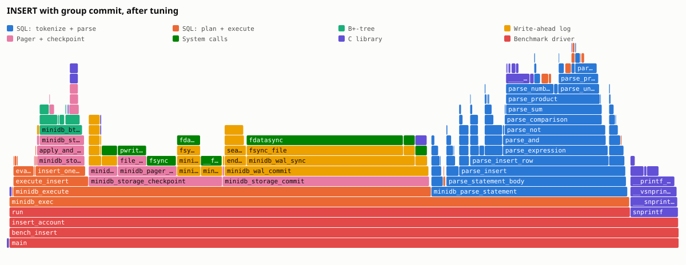

## 4. Sustained

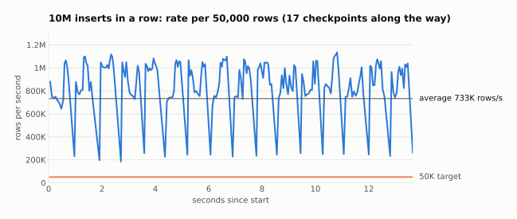

10 million rows in 13.7 s, 733K rows/s on average. The dips are the 17
checkpoints, each of which blocks inserts while it writes; the rate never
falls below 180K.

## 5. Reads

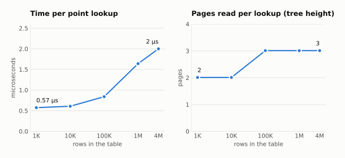

`SELECT ... WHERE id = ?` reads one page per tree level: 2 pages up to 10K
rows, 3 pages from 100K to 4M. Time grows from 0.6 to 2.0 µs over a 4,000×
larger table, the extra coming from CPU cache misses on a bigger tree. (The
table is fully cached here; a cold lookup adds one disk read per level.)

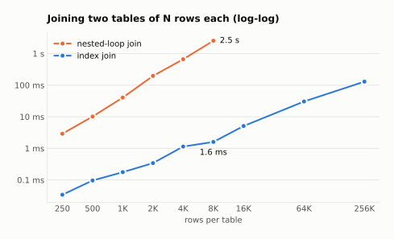

Joining on the right table's primary key probes its B+-tree once per left row:
O(n log n) overall. Without a usable key the join rescans the right table for
every left row, O(n²): at 8,000 rows a side, 1.6 ms against 2.5 s.

## What is left on the table

- **fsync is still 27% of an insert run.** A longer delay or larger group
  trades durability window for throughput; `OFF` shows the ceiling (846K).
- **Parsing is about 30%.** Prepared statements would skip it for repeated
  inserts.
- **Random inserts into a tree larger than the cache are checkpoint-bound**:
  55K rows/s at 2M rows. That still clears the target, but it is the weakest
  number here. A bigger cache moves the cliff; it does not remove it.

## Reproducing

```sh
scripts/run_benchmarks.sh /path/on/the/disk/to/test.db   # raw runs -> docs/benchmarks/
scripts/plot_benchmarks.py                               # charts   -> docs/img/
scripts/profile.sh out.svg insert --rows 2000000         # a flamegraph
```

The flamegraphs come from a sampler built into `minidb_bench` (a 1 kHz
wall-clock timer that records the call stack, weighting samples that a
blocking system call held back). It sees user-space frames only. Where `perf`
is installed, `perf record -g build/bench/minidb_bench insert` shows the same
picture with kernel frames under each system call.

Memory is checked the same way every time: `scripts/memcheck.sh` runs all ten
test binaries under Valgrind and fails on any error or leak.
